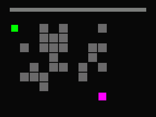

# Arcade Game Forge

Codexで小さなゲームを生成し、2つのWASMランタイムで検証して
[Scratch Arcade OS](https://github.com/ayutaz/scratch-arcade-os)で遊ぶツールです。
失敗を次の生成へ渡し、独立テストと同一packageの再ビルドを通ったものだけを採用します。

[English](README.md) · [導入](docs/setup.md) · [検証記録](docs/validation.md)



*ホストWASMの決定的な再生画像です。本体の録画や実時間の性能動画ではありません。*

## できたこと

新しく用意した3仕様から、実際のCodex CLIがCを生成しました。手修正はなく、
3本とも初回で独立規則・Wasmtime/WAMR・同一再ビルドを通過しました。

| ゲーム | package | 実機の結果 |
|---|---:|---|
| Crystal Maze | 1,332 B | 勝利、得点1 |
| Coin Trails | 1,667 B | 勝利、得点5 |
| Meteor Lane | 1,601 B | 勝利、得点3 |

自動実機試験でHOMEへ戻り、既存12本の版とhashを保持しました。
この試験で物理キーとLCDの見た目は確認していません。
3仕様の成功を一般的なAI成功率とは扱いません。対象は迷路・収集・回避の固定規則です。

## モデル認証なしで試す

[uv](https://docs.astral.sh/uv/)と[固定SDK](docs/setup.md)を用意します。

```sh
uv sync --locked
uv run --locked python -m arcade_game_forge sample maze \
  --sdk ../scratch-arcade-os --output runs/my-maze
uv run --locked python -m arcade_game_forge play runs/my-maze \
  --sdk ../scratch-arcade-os
```

`maze` / `collect` / `dodge`を選べます。公開したAI生成Cを再ビルド・検証するため、モデルを呼びません。
MacはZ開始・矢印移動・Rリセット・X終了。
本体はA開始・方向移動・Xリセット・B終了・FN+BでHOMEです。

## 新しく生成

ChatGPTで認証済みのローカルCodex CLIを使います。

```sh
uv run --locked python -m arcade_game_forge make examples/specs/maze.json \
  --sdk ../scratch-arcade-os --output runs/new-maze --attempts 3 --timeout 180
```

失敗した試行もローカルに保持します。時間/出力を制限し、読み取り専用sandbox、ツール使用なしで実行。
有料APIへの切替とGPU利用はありません。`make`は実機へ接続しません。
[実機の記録と配備範囲](docs/device-validation.md)。

## テスト

```sh
uv run --locked python -m unittest discover -s tests -v
uv run --locked python -m unittest discover -s tests/integration -v
```

標準試験はモデル認証/実機不要。統合試験は実SDKを使います。
[ゲーム規則](docs/specification.md)を参照してください。コード/生成サンプルは[Apache-2.0](LICENSE)です。
