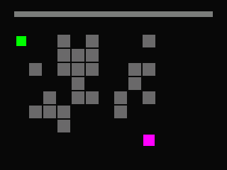

# Arcade Game Forge

Generate a small game with Codex, test it in two WASM runtimes, and play it on
[Scratch Arcade OS](https://github.com/ayutaz/scratch-arcade-os).
Failed tests feed the next attempt. Only a passing, reproducible package is accepted.

[日本語](README.ja.md) · [Setup](docs/setup.md) · [Evidence](docs/validation.md)



*Deterministic host WASM replay; not a handheld recording or real-time performance video.*

[22-second demo](docs/media/demo.mp4) — edited host replay with a synthetic soundtrack; Japanese captions. Not handheld footage.

## What works

Three new specifications produced these unedited games with the real Codex CLI.
Each passed the independent rules, Wasmtime/WAMR, and a matching rebuild on its first attempt.

| Game | Package | Handheld result |
|---|---:|---|
| Crystal Maze | 1,332 B | Won, score 1 |
| Coin Trails | 1,667 B | Won, score 5 |
| Meteor Lane | 1,601 B | Won, score 3 |

Automated device tests returned to HOME and preserved the 12 existing apps.
Physical buttons and the LCD were not visually checked in this test.
These three results are **not a general AI success rate**.
Forge supports closed maze, collection and dodge rules, not arbitrary game designs.

## Try a game without model access

Install [uv](https://docs.astral.sh/uv/) and prepare the [pinned SDK](docs/setup.md).

```sh
uv sync --locked
uv run --locked python -m arcade_game_forge sample maze \
  --sdk ../scratch-arcade-os --output runs/my-maze
uv run --locked python -m arcade_game_forge play runs/my-maze \
  --sdk ../scratch-arcade-os
```

Choose `maze`, `collect`, or `dodge`. Samples rebuild the published AI source and
run the independent tests; they do not call a model.
Mac controls: **Z** start, **arrows** move, **R** reset, **X** exit.
Handheld: **A**, **directions**, **X** reset, **B** exit, **FN+B** HOME.

## Generate a new version

Use an existing ChatGPT login in the local Codex CLI:

```sh
uv run --locked python -m arcade_game_forge make examples/specs/maze.json \
  --sdk ../scratch-arcade-os --output runs/new-maze --attempts 3 --timeout 180
```

Failures stay in the local run directory. Generation is bounded and read-only,
with no tool calls, paid API fallback, or GPU. `make` never connects to a handheld.
[Device evidence and deployment boundaries](docs/device-validation.md).

## Install an accepted game

With compatible Scratch Arcade OS already installed, detect its serial port and run:

```sh
uv run --locked python -m arcade_game_forge install runs/my-maze \
  --sdk ../scratch-arcade-os --port "$PORT"
```

Start from HOME with released keys. Updating an existing Forge app also requires
`--previous-sha` with its exact installed package hash. The CLI validates the
accepted artifact before connecting and checks that other apps stay unchanged.
It does not install or replace device firmware.

## Tests

```sh
uv run --locked python -m unittest discover -s tests -v
uv run --locked python -m unittest discover -s tests/integration -v
```

The default tests need no model login or device. Integration tests use the real SDK.
Read the [game contract](docs/specification.md). Code and generated samples: [Apache-2.0](LICENSE).

Release packaging: [source archive and checksum](docs/releases.md). No tagged release has been published yet.
